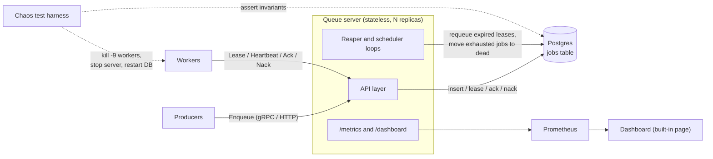
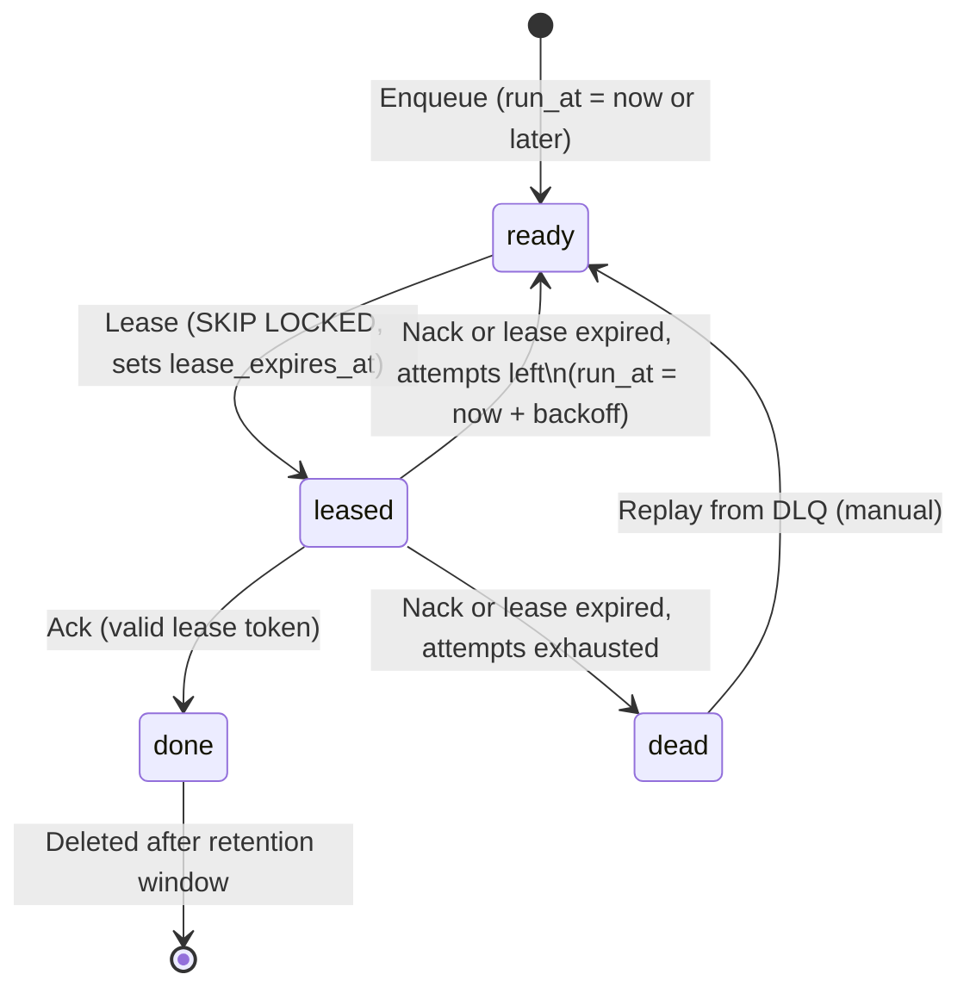

Status: Planned — implementation not started yet.

# go-task-queue

A distributed background-job queue in Go. This repository currently holds the **plan only**: scope, design, milestones, and how success will be measured. No queue code exists yet. Everything below describes what will be built, not what has been built.

## Problem

Web services need to push slow or failure-prone work (emails, webhooks, report generation, media jobs) out of the request path. A background queue has to answer hard questions that a simple in-memory channel or cron job cannot:

- What happens if a worker crashes halfway through a job?
- What happens if the same job is enqueued twice because a producer retried?
- What happens to a job that fails every time?
- How do I see backlog, latency, and failures while it runs?

The goal is a small, readable queue that gets these answers right and **proves them with tests that kill processes mid-job**, rather than a feature-rich clone of an existing product. It is a learning and demonstration project for backend infrastructure and reliability skills.

### Scope

In scope:

- Producers enqueue jobs over gRPC (primary) and HTTP/JSON (convenience).
- Workers lease jobs with a visibility timeout; leases can be extended by heartbeat.
- At-least-once delivery, with idempotency keys to dedupe enqueues.
- Retries with exponential backoff and jitter, then a dead-letter queue (DLQ) with replay.
- Scheduled / delayed jobs.
- Durable storage (decision in [Storage choice](#storage-choice-trade-offs)).
- Prometheus metrics and a small built-in dashboard.
- Chaos tests and a reproducible benchmark harness.
- Docker Compose for the whole stack.

Out of scope (v1): exactly-once execution, strict global ordering, multi-region replication, a multi-tenant auth system, cron-expression recurring jobs, priority queues, and job workflows/DAGs.

## Architecture

Workers never talk to the database directly. A stateless queue server owns all state transitions, so the delivery rules live in one place and can be tested in one place.



### Job lifecycle



### Core mechanics (design intent)

- **Lease.** `Lease(queue, n, visibility_timeout)` atomically claims up to `n` jobs whose `run_at <= now()`, increments `attempts`, sets `lease_expires_at`, and returns a fresh random `lease_token` per job.
- **Fencing by lease token.** `Ack`, `Nack`, and `Heartbeat` must present the current token. If a lease expired and the job was re-leased, the old worker's late `Ack` is rejected, so a slow or partitioned worker cannot mark someone else's attempt as done.
- **Heartbeat.** Long jobs extend their lease; the worker SDK will do this automatically while the handler runs.
- **Reaper.** A background loop (safe to run on every server replica, because its updates are conditional on `state = 'leased' AND lease_expires_at < now()`) returns expired leases to `ready` with backoff, or to `dead` when `attempts >= max_attempts`.
- **Backoff.** `delay = random(0, min(cap, base * 2^(attempt-1)))` (full jitter) to avoid retry stampedes. `base`, `cap`, and `max_attempts` are per-queue config.
- **Time source.** All lease and schedule comparisons use the database clock (`now()`), never worker or server clocks, to avoid skew bugs.
- **Idempotency keys.** `Enqueue` accepts an optional key. A unique `(queue, idempotency_key)` constraint plus `INSERT ... ON CONFLICT DO NOTHING` returns the existing job id for duplicate enqueues. Keys are retained at least as long as the job and its retention window.
- **Scheduling.** A delayed job is just a `ready` row with a future `run_at`; the lease query ignores it until due.

## Delivery guarantees and failure modes

**Guarantee: at-least-once.** A job that was accepted by `Enqueue` (the call returned success) will be executed to completion at least once, or end up in the DLQ after exhausting retries. It may execute **more than once**. Handlers must be idempotent, and the job id / idempotency key is exposed to the handler so it can dedupe its own side effects.

What the queue will *not* promise: exactly-once execution, strict ordering, or a bound on how late a job runs.

| Failure | What happens (design) | How it will be tested |
|---|---|---|
| Worker killed mid-job | Lease expires, reaper requeues with backoff, another worker runs it. Job may run twice. | Chaos: `kill -9` workers while jobs are in flight; assert every job reaches `done` or `dead`. |
| Worker slow, not dead | Lease expires while the handler is still running; job is re-leased. The slow worker's `Ack` is rejected (stale token). Duplicate side effects possible. | Handler that outlives its visibility timeout with heartbeat disabled. |
| Worker partitioned from server | Same as slow worker. | Pause the worker container in Compose. |
| Server crash mid-`Lease` or mid-`Ack` | Each transition is a single SQL statement/transaction, so it either happened or did not. A lost `Ack` means redelivery. | Kill the server during load; assert no lost jobs. |
| Producer retries `Enqueue` after timeout | Idempotency key collapses duplicates to one job. Without a key, duplicates are possible and documented. | Concurrent enqueues with the same key; assert one row. |
| Poison job (always fails) | Retried with backoff up to `max_attempts`, then moved to the DLQ so it stops consuming capacity. | Always-failing handler; assert it lands in the DLQ with `last_error` and attempt count. |
| Database restart / failover | Server returns retryable errors; clients retry. Committed jobs survive per Postgres durability settings. | Restart the Postgres container under load; assert no committed job is lost. |
| Reaper runs on several replicas | Conditional row updates make double-processing of a row harmless. | Run N replicas; assert attempt counts do not jump. |
| Clock skew between machines | Irrelevant to lease logic: only the DB clock is used. | Code-review rule, plus a skewed-clock container test if feasible. |

**Safety invariants the chaos tests will assert:**

1. Every acknowledged `Enqueue` ends in exactly one terminal state: `done` or `dead`.
2. No job is silently dropped (set of enqueued ids = set of terminal ids).
3. A job is never `done` unless a worker's `Ack` succeeded for its current lease token.
4. A job is never started more than `max_attempts` times by the queue.
5. Duplicate executions are allowed, but are counted and reported, not hidden.

## Storage choice: trade-offs

Two options will be compared, and one will be used for v1.

| Dimension | Postgres + `FOR UPDATE SKIP LOCKED` | Custom append-only log on disk |
|---|---|---|
| Durability | Mature WAL, fsync, replication, backups | Must be built and verified: segment files, fsync policy, torn-write recovery, checksums |
| Competing consumers | `SKIP LOCKED` gives non-blocking multi-consumer claims out of the box | Must be built: in-memory index of ready/leased jobs, rebuilt on restart |
| Delayed / scheduled jobs | `run_at` column + index | Needs a timer wheel or sorted structure, rebuilt from the log on start |
| Idempotency keys | Unique index | Own index or hash map, plus its persistence and compaction |
| Retries, DLQ, inspection, ad-hoc queries | Plain SQL | Custom tooling for every question |
| Operations | One more dependency, but a well-known one | No external dependency, but all operational risk is ours |
| Write path cost | State changes are row updates that leave dead tuples; needs vacuum tuning, fast deletion of finished jobs or time partitioning | Sequential appends are cheap; compaction/GC of the log is the cost |
| Throughput ceiling | Bounded by Postgres write and lock overhead (to be measured, not assumed) | Potentially higher for append-only writes; unproven until measured |
| Correctness risk | Lower: reuses tested primitives | Higher: crash-recovery bugs are exactly what this project tests for |
| Learning value | Index design, locking, vacuum, query plans | Storage-engine and recovery design |

**Decision: Postgres with `SKIP LOCKED` for v1.** The project's claim is *reliability*, and Postgres lets the limited time go into delivery semantics, chaos tests, and measurement instead of re-implementing a durable store. A narrow `Store` interface (`Enqueue`, `Lease`, `Ack`, `Nack`, `Heartbeat`, `Reap`, `Stats`) will keep the storage layer swappable.

**Stretch (final milestone):** a spike of an append-only-log `Store` behind the same interface, run through the **same chaos suite and benchmark harness**, so the table above gets replaced by measurements. If the spike is not finished, the write-up will say so.

Postgres details to design carefully: a partial index on ready jobs ordered by `(queue, run_at)`, a unique index for idempotency keys, short transactions, batch leasing, and a retention job for finished rows. Whether `LISTEN/NOTIFY` wake-ups beat polling will be decided by measurement.

## Tech stack

| Area | Choice |
|---|---|
| Language | Go |
| API | gRPC with protobuf (primary); small HTTP/JSON surface for `curl`, health, and the dashboard |
| Storage | PostgreSQL via `pgx`, SQL migrations; optional custom log store as a stretch |
| Worker client | Go SDK: concurrency control, automatic heartbeat, graceful shutdown |
| Metrics | Prometheus client for Go, scraped by a Prometheus container |
| Dashboard | Small static page served by the queue server, reading a JSON stats endpoint |
| Tests | `go test`, integration tests against real Postgres in containers, a separate chaos suite |
| Packaging | Docker, Docker Compose (server, N workers, Postgres, Prometheus) |
| CI | GitHub Actions: lint, unit and integration tests; chaos suite on demand |

Specific library versions will be chosen at implementation time.

## Observability

Planned Prometheus metrics (names are provisional):

- Counters: jobs enqueued, leased, acked, nacked, retried, dead-lettered, lease-expired, duplicate enqueues deduped.
- Gauges: jobs by state per queue, age of the oldest ready job, active leases.
- Histograms: enqueue-to-lease wait, enqueue-to-ack latency, handler duration, RPC latency.

The built-in dashboard will show depth by state, oldest-job age, throughput, retry and DLQ counts, and recent dead jobs with their last error.

## Milestones and done-criteria

| # | Milestone | Done when |
|---|---|---|
| M0 | Foundations | Repo layout, CI, Compose with Postgres, schema + migrations, `Store` interface defined. `go test ./...` runs in CI. |
| M1 | Core queue | Enqueue, lease (SKIP LOCKED), ack, nack on Postgres. Integration tests show two competing consumers never hold the same live lease. |
| M2 | Network API + worker SDK | gRPC and HTTP serve all calls. The SDK runs a handler with concurrency and graceful shutdown. A producer and a worker run end-to-end in Compose. |
| M3 | Reliability | Visibility timeout, heartbeat, reaper, backoff with jitter, DLQ with replay, idempotency keys. Each has a test for its failure case from the table above. |
| M4 | Scheduling and retention | Delayed jobs never run before `run_at`. Finished jobs are cleaned up. Graceful server shutdown drains in-flight RPCs. |
| M5 | Observability | `/metrics` exposes the planned metrics, Prometheus scrapes it in Compose, the dashboard shows live state. |
| M6 | Chaos tests | Suite kills workers, the server, and Postgres under load and asserts all five safety invariants. It runs repeatedly without a violation, and the run count is recorded. |
| M7 | Benchmarks | Harness and methodology (below) run from one command; results with hardware and configuration are published in `docs/benchmarks.md`. |
| M8 | Stretch: log store + write-up | Append-only-log `Store` passes the same integration and chaos suites, or the write-up states where it did not. This README's status line is updated to reflect reality. |

The week-by-week breakdown is in [PLAN.md](PLAN.md).

## Benchmark plan

To be run after M6, never before correctness is established. No results exist yet and none are claimed here.

**What will be measured**

- Enqueue throughput (jobs/sec) with N producers.
- End-to-end throughput (jobs/sec) from enqueue to ack with a no-op handler, so the queue is measured rather than the handler.
- End-to-end latency, enqueue to ack: p50, p90, p99, max, as a histogram.
- Enqueue-to-lease wait separately from handler time.
- Behaviour under backlog: latency and throughput as queue depth grows.
- Recovery time after a worker kill: time until in-flight jobs are redelivered (bounded by the visibility timeout).

**Variables to sweep, one at a time**

Producer count, worker count, lease batch size, visibility timeout, payload size, Postgres `synchronous_commit`, polling vs `LISTEN/NOTIFY`, and (if built) Postgres store vs log store.

**Method rules**

- A Go load generator drives the real gRPC API; latency is recorded with an HDR histogram.
- Open-loop mode (fixed arrival rate) for latency, to avoid coordinated omission; closed-loop mode (as fast as possible) for peak throughput.
- Warm-up discarded; repeated runs; report the median and spread across runs, not a single best run.
- Record hardware, OS, Go version, Postgres version and config, and Compose resource limits next to every result. Laptop runs will be labelled as such.
- Publish scripts and raw output so anyone can reproduce.

## Success metrics (to be measured later)

No targets are invented in advance. Each metric gets a baseline from the first benchmark run, and any target is set after that.

| Metric | How it is measured |
|---|---|
| Lost jobs under chaos | Count of acknowledged enqueues missing from terminal states. **Must be 0** in every chaos run. |
| Chaos runs completed | Number of randomized chaos runs with all invariants holding. |
| Duplicate execution rate | Duplicate executions / total executions under worker-kill chaos. Reported, not hidden. |
| Peak sustained throughput | Jobs/sec, enqueue to ack, from the benchmark harness. |
| Latency | p50 and p99 enqueue-to-ack at a stated arrival rate. |
| Recovery time | Time from worker kill to redelivery of its jobs. |
| Test coverage of delivery logic | Coverage of the store and reaper packages, plus the list of failure modes that have a passing test. |
| Postgres vs log store | Same benchmark and chaos suite on both stores, if the stretch milestone is reached. |

## Interview talking points

- **At-least-once vs exactly-once:** why exactly-once execution is not achievable across a crash boundary, and how at-least-once plus idempotent handlers gets the practical result.
- **Visibility timeout trade-off:** short timeouts recover fast but cause duplicate runs for slow jobs; long timeouts delay recovery. Heartbeats let timeouts stay short while long jobs stay leased.
- **Fencing tokens:** why a stale worker's `Ack` must be rejected, and what that does and does not protect (queue state, not external side effects).
- **Idempotency keys:** what they dedupe (enqueue) versus what they cannot (handler side effects), and how a handler can use the job id for its own dedupe.
- **`SKIP LOCKED`:** how it turns Postgres rows into a non-blocking multi-consumer queue, and why `ORDER BY ... LIMIT ... FOR UPDATE SKIP LOCKED` needs a matching index.
- **Postgres as a queue:** update churn, dead tuples, vacuum, partial indexes, and when this approach stops being enough.
- **Retry design:** exponential backoff with full jitter to avoid thundering herds; poison messages and why a DLQ protects capacity.
- **Clock handling:** using the database clock as the single time source.
- **Testing reliability:** defining invariants, injecting failures (`kill -9`, server stop, DB restart), and asserting on terminal states instead of eyeballing logs.
- **Benchmarking honestly:** open vs closed loop, coordinated omission, percentiles over averages, reporting hardware and variance.
- **Decision records:** why Postgres was chosen for v1, and what evidence would justify the log store.

## Repository layout (planned)

```
cmd/queued/        queue server
cmd/worker-demo/   example worker
cmd/chaos/         chaos test driver
cmd/bench/         load generator
internal/store/    Store interface, postgres store, (stretch) log store
internal/server/   gRPC + HTTP handlers, reaper, scheduler
internal/metrics/  Prometheus metrics
pkg/worker/        worker SDK
proto/             protobuf definitions
migrations/        SQL migrations
deploy/            docker-compose.yml, prometheus.yml
docs/              design notes, benchmarks (after they exist)
site/              static plan page
```

This layout is a plan and may change.

## License

To be decided before the first code is added.
